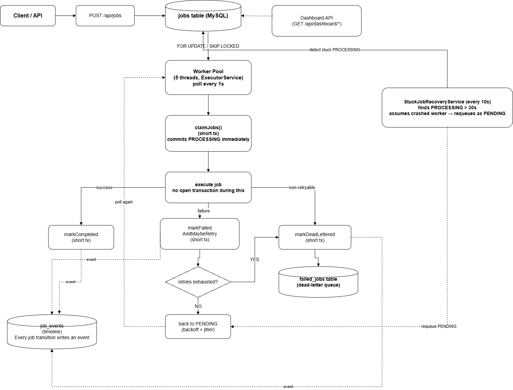

# JobFlow — Distributed Asynchronous Task Scheduler & Job Queue Engine

A broker-free background job processing system built in Java, Spring Boot, and MySQL. Clients submit jobs via a REST API; a pool of concurrent workers picks them up, processes them, retries failures with exponential backoff and jitter, and moves permanently failed jobs to a dead-letter queue. A live console shows real-time system health.

---

## The Problem

Every production system eventually needs to run work in the background — sending emails, exporting PDFs, resizing images, calling slow third-party APIs — without blocking the user's request. The standard solution is a message broker like Redis (BullMQ), RabbitMQ, or Kafka.

This project deliberately does **not** use one of those. Instead, it builds the same core guarantees — safe concurrent processing, retries, failure isolation — directly on top of MySQL, using the `jobs` table itself as the queue.

**Why build it this way?** Using a broker hides the hard problems behind a library. Building it from scratch forces you to actually solve:
- How do you stop two workers from grabbing the same job?
- How do you recover a job when the worker processing it crashes mid-way?
- How do you retry a failed job without hammering a broken downstream service?
- How do you tell the difference between "retry this" and "never retry this"?

This repo is the answer to all four.

---

## How the System Works

### Architecture



The diagram shows the full lifecycle: a job is submitted, claimed by a worker in its own short transaction (so its `PROCESSING` state is immediately visible to the rest of the system), executed with no open transaction, and then routed to one of three short, independent outcomes — completed, retried with backoff, or dead-lettered. A separate recovery service polls independently for jobs whose `PROCESSING` lock has gone stale, assumes the worker that held it crashed, and requeues them. Every transition along the way writes an event to `job_events`, which is what powers the timeline view.

### Job Lifecycle

```
PENDING → PROCESSING → COMPLETED
PENDING → PROCESSING → FAILED → (retry, backoff+jitter) → PENDING → ...
FAILED  → (max retries exceeded) → DEAD_LETTERED
PROCESSING → (worker crash, no update for 30s) → detected by recovery service → PENDING
```

### Key mechanisms

| Mechanism | How |
|---|---|
| **Concurrency safety** | `SELECT ... FOR UPDATE SKIP LOCKED` — two workers can never grab the same row, even under load. |
| **Priority ordering** | `CASE priority WHEN 'HIGH' THEN 1 ...` in the pickup query — high priority jobs are always fetched first. |
| **Retry logic** | Exponential backoff (`2^attempt` seconds) + random jitter (0–1000ms), capped at `maxRetries` (default 5) before dead-lettering. |
| **Dead-letter queue** | Separate `failed_jobs` table, so the hot `jobs` table stays small and fast for workers to poll. |
| **Non-retryable failures** | A dedicated `NonRetryableException` (e.g. malformed payload) skips retries entirely and goes straight to the DLQ — no wasted attempts. |
| **Crash/timeout recovery** | A scheduled job scans for `PROCESSING` rows whose lock is older than 30s and requeues them, assuming the worker died. |
| **Idempotency** | Optional client-supplied `idempotencyKey`; resubmitting the same key returns the original job instead of creating a duplicate. |
| **Graceful shutdown** | On `SIGTERM`/Ctrl+C, workers stop picking up new jobs and get up to 30s to finish in-flight jobs before the process exits. |
| **Observability** | Every state transition is logged to a `job_events` table, giving a full timeline per job (`QUEUED → PICKED_UP → COMPLETED`). |

---

## How to Run It

### Prerequisites
- Java 21+
- Maven
- MySQL 8.0+ running locally

### Setup

1. Create the database (or let Hibernate do it automatically — see note below):
   ```sql
   CREATE DATABASE jobflow;
   ```
   A full reference schema is also provided in `schema.sql` if you'd rather run migrations manually.

2. Configure environment variables (or edit `application.yml` defaults directly):
   ```
   DB_URL=jdbc:mysql://localhost:3306/jobflow?createDatabaseIfNotExist=true&useSSL=false&serverTimezone=UTC
   DB_USERNAME=root
   DB_PASSWORD=your_password
   ```
   See `.env.example` for the full list of configurable values (worker pool size, poll interval, retry delays, stuck-job threshold).

3. Run the app:
   ```
   mvn spring-boot:run
   ```
   or run `JobflowApplication.java` directly from your IDE.

4. Open the built-in test console at:
   ```
   http://localhost:8080/dashboard.html
   ```
   This lets you submit jobs (including simulated failures), check status/timelines, and watch the dead-letter queue live — no Postman required, though a Postman collection is also included for API-level testing.

### Core REST API

| Method | Endpoint | Purpose |
|---|---|---|
| POST | `/api/jobs` | Submit a new job |
| GET | `/api/jobs/{id}` | Check job status |
| GET | `/api/jobs/{id}/timeline` | Full event history for a job |
| GET | `/api/dashboard/stats` | Live counts by status |
| GET | `/api/dashboard/metrics` | Avg processing time, throughput, failure % |
| GET | `/api/dead-letter` | List dead-lettered jobs |
| POST | `/api/dead-letter/{id}/retry` | Manually requeue a dead-lettered job |

### Simulating failures on demand

Instead of relying on random chance, jobs can request a specific failure mode via their payload:

```json
{ "type": "email", "payload": "{\"simulateFailure\":\"MALFORMED\"}" }
```

| Value | Behavior |
|---|---|
| `MALFORMED` | Throws a non-retryable exception → instant dead-letter, no retries wasted |
| `TRANSIENT` | Normal retryable failure → goes through backoff/retry logic |
| `TIMEOUT` | Sleeps 60s, simulating a hung job → caught by the stuck-job recovery service |
| `CRASH` | Kills the JVM (`Runtime.getRuntime().halt(1)`) to simulate a real worker crash |

---

## Trade-offs & Design Decisions

**Why MySQL instead of Redis/Kafka/RabbitMQ?**
Deliberate — the goal was to demonstrate the underlying queuing mechanics (locking, retries, failure isolation) rather than delegate them to a broker. This is the direct answer to "why not just use RabbitMQ?" in an interview.

**Why a fixed-size thread pool instead of a dynamic one?**
Prevents resource exhaustion under load — a fixed pool is a deliberate concurrency control choice, not a limitation.

**Why is retry logic split into short, separate transactions instead of one big one?**
This was a real bug found and fixed during development (see below) — worth reading if you're evaluating this project.

**Why `ddl-auto=update` instead of Flyway/Liquibase migrations?**
Convenience for a solo 4-day build. A production system would use versioned migrations instead; `schema.sql` is provided as the equivalent reference schema.

### The transaction-visibility bug (found and fixed during development)

Early on, `processNextBatch()` was a single `@Transactional` method: claim a job, mark it `PROCESSING`, do the work (which could take up to 60s in the TIMEOUT test case), then mark it `COMPLETED`. Because the whole method ran in one transaction, **the `PROCESSING` status was never actually committed to the database until the entire method finished** — meaning `StuckJobRecoveryService`, which polls in its own transaction, could never see a job as "stuck," because as far as the database was concerned, it was never in `PROCESSING` at all until it was already done.

**Fix:** the pickup, completion, and failure-handling logic were split into three separate, short-lived transactions (`claimJobs`, `markCompleted`, `markFailedAndMaybeRetry`) in a dedicated `JobTransactionService`. Now `PROCESSING` is committed and visible to other parts of the system the instant a job is claimed — which is what makes the crash/timeout recovery test actually work.

This is a genuine example of a subtle but important distributed-systems bug: **the difference between "the code compiles and looks right" and "the state is actually visible where it needs to be."**

---

## Load Test Results

Run via the built-in load-test panel in `dashboard.html`, which submits N jobs back-to-back via the real REST API, then polls until every one of them reaches a final state.

**50 jobs, mixed workload (normal + simulated MALFORMED/TRANSIENT failures), default worker pool (5 threads):**

| Metric | Result |
|---|---|
| Submit time | 1.51s |
| Processing time | 61.65s |
| Total wall time | 63.17s |
| End-to-end throughput | 0.79 jobs/sec |
| Completed | 43 / 50 |
| Dead-lettered | 7 / 50 |
| Failure rate | 14.0% |

All 50 jobs were accepted in under 2 seconds — confirming the submit path scales independently of processing time. Of the 7 jobs that landed in the dead-letter queue, the `MALFORMED` ones were routed there immediately with zero wasted retry attempts (non-retryable path), while `TRANSIENT` ones exhausted all 5 retries with exponential backoff before being dead-lettered — both behaving exactly as designed. No job was lost, stuck, or double-processed under concurrent load.

---

## Known Limitations

- **Single-node, not truly distributed.** This runs as one Spring Boot process with multiple worker *threads*. Because the concurrency control (`FOR UPDATE SKIP LOCKED`) is enforced at the database level rather than in application memory, running multiple *instances* of this app against the same MySQL database would work correctly with zero code changes — but this hasn't been demonstrated end-to-end in this build.
- **No fencing token on job completion.** If a worker is marked "stuck" and its job is requeued, but the original worker thread is still alive and finishes shortly after, it can still call `markCompleted()` on a job that's already been picked up again. In this project's demo scenarios this is harmless, but a production system would add a version/fencing check so a stale worker can't overwrite a newer attempt.
- **No authentication.** Intentionally out of scope — this is an internal system, not a user-facing one.
- **`ddl-auto=update` instead of real migrations.** Fine for a solo project; a team project would use Flyway or Liquibase.
- **No frontend framework.** The included `dashboard.html` is a single static page using vanilla JS and polling — intentionally minimal, built to visualize and test the backend, not as a production UI.

---

## Tech Stack

Java 21 · Spring Boot · Spring Data JPA / Hibernate · MySQL · `ExecutorService` (worker pool) · Lombok · JUnit 5

## Tests

Run with `mvn test`. Covers: job submission defaults, idempotency (duplicate prevention), non-retryable failures skipping straight to dead-letter, and not-found error handling.
